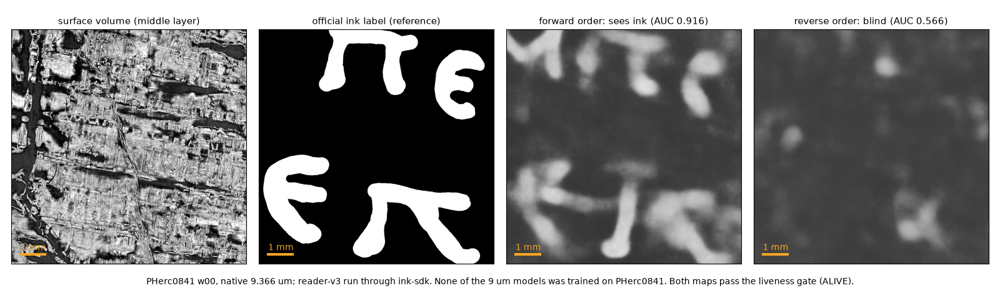

# ink-sdk

Standalone inference for Vesuvius ink models. Give it an already rendered surface volume, or a `tifxyz`
mesh plus a local OME-Zarr CT. It writes a probability map, a preview, a receipt and a liveness verdict.
Hecate can also write a 3D zarr.

**Inference only.** No training, fine-tuning, OCR or scientific evaluation.



*One real run on public data none of the 9 µm models was trained on (PHerc0841 w00, Reader V3; the official ink
label is shown for reference only, on the 1024 px crop with the most labelled ink). The same model sees the letters
in one depth order and is blind in the other, and both maps pass the liveness gate, so the depth direction matters.*

## Quick start

```bash
git clone https://github.com/LimeGS/ink-sdk.git
cd ink-sdk
python -m pip install -e '.[all]'

ink-sdk fetch --profile hecate@2.4um    # or `ink-sdk fetch` for all of them
ink-sdk doctor
```

Run on an already rendered surface volume:

```bash
ink-sdk infer \
  --profile hecate@2.4um \
  --surface-volume /data/segments/PHercParis4/surface-volumes/2.4um.zarr \
  --pixel-um 2.4 \
  --out runs/hecate-2.4
```

Or render from a mesh + CT first:

```bash
ink-sdk infer \
  --profile hecate@2.4um \
  --tifxyz /data/segments/PHercParis4/mesh \
  --ct /data/ct/PHercParis4/level0.zarr \
  --voxel-um 2.4 \
  --normal outward \
  --out runs/hecate-2.4
```

`ink-sdk fetch` is opt-in: inference never downloads weights. `ink-sdk doctor` marks each checkpoint
`verified`, `missing` or `present-but-unverified`.

## Models

| Profile | Scale | Depth | Output | Notes |
|---|---:|---:|---|---|
| `ink_9um@scrollprize-seed42-step75000` | 9.6 ± 0.5 µm | 17 | 2D | VILLA; both directions |
| `ink_9um@scrollprize-seed43-step75000` | 9.6 ± 0.5 µm | 17 | 2D | VILLA; both directions |
| `ink_9um@reader-v2-step040000` | 9.6 ± 0.5 µm | 17 | 2D | VILLA; both directions |
| `ink_9um@reader-v3` | 9.362 ± 0.75 µm | 17 | 2D | VILLA; both directions |
| `ink_9um@dense-native-step016000` | 9.362 ± 0.75 µm | 17 | 2D | VILLA; both directions; checkpoint rebuilt by `fetch` |
| `canonical_2um@r152-3ddec-v2-l5-epoch13` | 2.399 ± 0.05 µm | 62 | 2D | forward only |
| `hecate@2.4um` | 2.4 ± 0.048 µm | 64 | 2D / 3D | 3D with `--output-3d` |
| `hecate@9.6um` | 9.6 ± 0.192 µm | 16 | 2D / 3D | 3D with `--output-3d` |

`ink-sdk models` lists them; `ink-sdk models --json` also shows checkpoint paths and SHA-256 values.

Seed 42 and dense_native are the two models Erwin Nieuwlaar added to the public set in his PHerc0343 First
Letters recipe ([Nieuwlaar/pherc343-first-letters](https://github.com/Nieuwlaar/pherc343-first-letters)).
dense_native ([Nieuwlaar/ink9um-dense-native](https://huggingface.co/Nieuwlaar/ink9um-dense-native), MIT) is
published as weights plus training config, not as the `.pth` VILLA loads. `ink-sdk fetch` downloads both pinned
files and rebuilds the checkpoint with his recipe, which needs `torch` and `safetensors`. The pinned digest was
produced with torch 2.10; another torch version may write different bytes, and `fetch` then says so.

## What a run writes

| File | Meaning |
|---|---|
| `probability.npy` | Forward map, float32 `[0, 1]`, shape `(y, x)` |
| `probability_reverse.npy`, `probability_mean.npy` | Extra maps when produced |
| `probability_primary.npy` | Copy of the selected map when the primary is not forward |
| `preview.tif` | Display preview of the primary map |
| `ink_3d.zarr` | Hecate 3D output with `--output-3d` |
| `render/` | Render `0` array and `RENDER_RECEIPT.json` when rendered |
| `INK_SDK_RECEIPT.json` | Profile, checkpoint, scale, render, stats, liveness, environment |
| `LANE_NOT_USABLE` | Present when the liveness gate refuses the lane |

The receipt is the source of truth. A probability map is not evidence of ink, letters or a First Letter.

---

<details>
<summary><b>Model notes</b> — 9 µm (seed43, reader-v2), canonical 2 µm, Hecate 2.4 / 9.6</summary>

Most examples start from a surface volume. For a mesh, replace `--surface-volume ... --pixel-um ...` with
`--tifxyz ... --ct ... --voxel-um ...`; canonical and Hecate also require `--normal inward|outward` for a mesh.

### 9 µm: seed43 and reader-v2

```bash
export VILLA=/opt/ScrollPrize-villa

ink-sdk infer \
  --profile ink_9um@scrollprize-seed43-step75000 \
  --surface-volume /data/segments/SCROLL/surface-volumes/9.362um.zarr \
  --pixel-um 9.362 \
  --villa "$VILLA" \
  --out runs/seed43
```

Swap the profile ID for `ink_9um@reader-v2-step040000` to run reader-v2. The VILLA checkout must contain
`ink-detection/koine_machines/inference/infer.py` and make `vesuvius` importable. `imagecodecs` is required.

Both profiles produce `forward`, `reverse` and `mean` maps. Use `--primary reverse` or `--primary mean` to
select a different primary map.

For an 8.64 µm CT, add `--resample-from-um 8.64` and install the `render` extra for `scipy` in addition to
`ink9um`:

```bash
ink-sdk infer \
  --profile ink_9um@scrollprize-seed43-step75000 \
  --tifxyz /data/segments/SCROLL/mesh \
  --ct /data/ct/SCROLL/level0.zarr \
  --voxel-um 8.64 \
  --resample-from-um 8.64 \
  --villa "$VILLA" \
  --out runs/seed43-8.64
```

A 2.4 µm source is pooled 4× to 9.6 µm automatically.

### canonical 2 µm

```bash
ink-sdk infer \
  --profile canonical_2um@r152-3ddec-v2-l5-epoch13 \
  --surface-volume /data/segments/PHAEDRUS/surface-volumes/2.399um.zarr \
  --pixel-um 2.399 \
  --out runs/canonical
```

The adapter uses 62 central layers, 256 px tiles and a Hann window. It accepts 2.399 ± 0.05 µm and has no
pooling or upsampling path. The input must have at least 62 layers. `--deterministic` enables deterministic
PyTorch algorithms.

### Hecate 2.4 µm

```bash
ink-sdk infer \
  --profile hecate@2.4um \
  --surface-volume /data/segments/PHercParis4/surface-volumes/2.4um.zarr \
  --pixel-um 2.4 \
  --output-3d \
  --out runs/hecate-2.4
```

Hecate 2.4 uses 64 layers. It does not resample. `--output-3d` adds `ink_3d.zarr`; only the evaluated depth
interval is populated. The checkpoint runs in fp32 by default; `--amp bf16` is available on CUDA.

### Hecate 9.6 µm

```bash
ink-sdk infer \
  --profile hecate@9.6um \
  --surface-volume /data/segments/SCROLL/surface-volumes/9.6um.zarr \
  --pixel-um 9.6 \
  --out runs/hecate-9.6
```

Hecate 9.6 uses 16 layers. A 2.4 µm source is pooled 4× to 9.6 µm; a native 8.64 µm source is rejected.
Add `--output-3d` for a 3D zarr.

</details>

<details>
<summary><b>Installation options</b> — extras and the external renderer</summary>

`[all]` is the easiest install. Use only the extras you need:

| Extra | Adds | Needed for |
|---|---|---|
| `render` | `scipy` | `--umbilicus`, `--resample-from-um` |
| `canonical` | `torch` | canonical 2 µm |
| `hecate` | `torch`, `scipy` | Hecate 2.4 and 9.6 |
| `ink9um` | `torch`, `imagecodecs` | both 9 µm profiles |
| `fetch` | `huggingface_hub` | `ink-sdk fetch` |
| `test` | `pytest`, `pytest-cov` | the test suite |

The external `vc_render_tifxyz` binary is not installed by pip; see *Inputs* below.

If `torch.cuda.is_available()` is `False` after install, the wheel may be built for a newer CUDA than your
driver; reinstall torch from the matching index, e.g.
`pip install --force-reinstall torch --index-url https://download.pytorch.org/whl/cu128`.

</details>

<details>
<summary><b>Inputs</b> — surface volume, mesh + CT, renderer, ROI</summary>

### Surface volume

`--surface-volume` accepts a ZYX `uint8` array as `.npy`, 3D TIFF, numbered TIFF stack, or a Zarr group
containing array `0`. Pass `--pixel-um` unless the data carries OME/scale metadata. `--voxel-um` is the same
override for mesh renders.

### Mesh + CT

A `tifxyz` directory needs `x.tif`, `y.tif`, `z.tif` and a complete `meta.json`. The CT must be a local,
uint8 OME-Zarr v2:

```text
ct.zarr/
├── .zattrs
└── 0/
    ├── .zarray     # dtype must be |u1
    └── ...
```

Only levels that exist may be announced in the multiscale metadata. Zarr v3 CT input is not supported;
surface volumes may use v3. The SDK never downloads CT or surface volumes; only `ink-sdk fetch` uses the
network, for weights.

The renderer is the official `vc_render_tifxyz` from volume-cartographer/VC3D, usually an AppImage `AppRun`.
Pass `--renderer /path/to/AppRun` to `infer` or `render`, or set an environment variable:

```bash
export INK_SDK_RENDERER=/path/to/AppRun
# or
export VC3D_APPRUN=/path/to/AppRun
```

Canonical and Hecate need `--normal inward|outward` (or `--umbilicus`) when rendering from a mesh; the SDK
will not guess the direction. The 9 µm profiles run both directions and may omit it.

Render once, then reuse the result:

```bash
ink-sdk render \
  --profile canonical_2um@r152-3ddec-v2-l5-epoch13 \
  --tifxyz /data/segments/PHAEDRUS/mesh \
  --ct /data/ct/PHAEDRUS/level0.zarr \
  --voxel-um 2.4 \
  --normal outward \
  --out renders/phaedrus

ink-sdk infer \
  --profile canonical_2um@r152-3ddec-v2-l5-epoch13 \
  --surface-volume renders/phaedrus/render \
  --pixel-um 2.4 \
  --out runs/canonical
```

`--roi y0,y1,x0,x1` is half-open and applies after scaling, in output-map pixels. The render is not cropped
to the ROI: the receipt records `render_crop = null` and
`render_crop_application = "not-implemented-post-render-roi"`.

</details>

<details>
<summary><b>Scale and orientation</b> — what each profile accepts, and depth direction</summary>

| Source | 9 µm | canonical 2.399 | Hecate 2.4 | Hecate 9.6 |
|---|---|---|---|---|
| 2.4 µm | pool 4× → 9.6 | native | native | pool 4× → 9.6 |
| 2.399 µm | pool 4× → 9.596 | native | native | pool 4× → 9.596 |
| 8.64 µm | resample → 9.362 with flag | reject | reject | reject |
| 9.362 µm | native | reject | reject | reject |
| 9.596 µm | native | reject | reject | native |

If no row applies, the SDK rejects the source instead of stretching it. `--resample-from-um 8.64` is the
only opt-in resample: XY only, no prefilter.

Without an umbilicus, depth orientation is ambiguous. The 9 µm profiles keep both directions and mark the
orientation unverified; canonical and Hecate require `--normal` or `--umbilicus` when rendering from a mesh.
A user-declared normal is recorded as `orientation_source = "user-declared"`; reading orientation remains
unverified.

</details>

<details>
<summary><b>Profiles (templates)</b> — use by ID, copy and modify, custom directories</summary>

The TOMLs in `src/ink_sdk/profiles/` are the default profile templates. In an installed wheel, find the
packaged copies with:

```bash
python -c "import ink_sdk, pathlib; print(pathlib.Path(ink_sdk.__file__).parent / 'profiles')"
```

They are data, not code:

| Layer | Controls |
|---|---|
| adapter code | preprocessing, tiling, limits |
| renderer code | native render, orientation, cache |
| profile TOML | checkpoint, scale, depth, execution, primary output |

You normally use them by ID; no copy is needed:

```bash
ink-sdk infer --profile hecate@2.4um ...
ink-sdk inspect --profile 2.4um ...      # unique suffix also works
ink-sdk infer --profile ./my-profile.toml ...
```

`ink-sdk inspect` is a dry run: it prints the scale/render plan and does not load weights.

### Modify a template

1. Copy a TOML out of `site-packages` or the source tree. Do not edit the installed package; the next
   install overwrites it.
2. Give it a new unique `id`.
3. Keep `adapter` and `family` compatible: `ink9um` or `canonical2um` with `surface-volume-2d`, `hecate` with
   `surface-volume-3d2d`.
4. Update `checkpoint.path`, `checkpoint.upstream_path`, `checkpoint.sha256` (64 lowercase hex) and
   `checkpoint.bytes` (exact size). No checkpoint has a default.
5. Update `source.repo` and `source.revision` if you are registering a different release.
6. Validate and fetch:

```bash
ink-sdk inspect --profile ./my-profile.toml \
  --surface-volume /data/segments/PHercParis4/surface-volumes/2.4um.zarr \
  --pixel-um 2.4

ink-sdk fetch --profile ./my-profile.toml
```

To make custom profiles visible in `ink-sdk models` and `ink-sdk doctor`:

```bash
export INK_SDK_PROFILES=$HOME/ink-profiles
ink-sdk models
```

All `*.toml` files in each directory are loaded before the packaged profiles. Duplicate IDs are an error,
not an override.

### Profile fields that matter

| Field | Meaning |
|---|---|
| `input.scale_um`, `scale_tolerance_um` | Native scale and accepted tolerance |
| `input.depth` | Required layer count |
| `input.normalization`, `divisor` | Canonical uses `divisor`; Hecate and 9 µm use the checkpoint |
| `input.tile`, `stride`, `overlap`, `min_valid_ratio` | Adapter-specific tiling |
| `execution.direction` | `forward`, `reverse` or `both`; canonical is forward-only |
| `execution.amp` | Profile default; `--amp` overrides where supported |
| `output.primary` | Primary map for preview and `probability_primary.npy` |
| `output.no_ink_floor` | Recorded in the receipt; not applied as a threshold |

For a full annotated example, start from `src/ink_sdk/profiles/hecate-2.4um.toml` and change the `id`,
checkpoint and model facts. Use `--profile ./my.toml` for one-off runs.

</details>

<details>
<summary><b>Liveness and exit codes</b></summary>

The gate checks the primary map:

- `EMPTY`: no valid pixels.
- `DEGENERATE`: `p99 - p50 < 0.05`, `std < 0.02`, or more than 90% of pixels within 0.05 of 0.5.
- `ALIVE`: none of the above.

`ALIVE` means the map carries a decision, not that the decision is right: in the figure above both maps are
`ALIVE`.

`--on-degenerate fail` (default) exits 3 and keeps the map and receipt. `--on-degenerate warn` continues and
exits 0. Exit codes: `0` success, `2` validation/dependency/render error, `3` refused degenerate lane.
If `out/` is not empty, inference refuses to overwrite it unless `--overwrite` is passed.

</details>

<details>
<summary><b>CLI and environment variables</b></summary>

```text
ink-sdk models [--json]
ink-sdk fetch [--profile ID|TOML ...] [--models-dir PATH] [--overwrite]
ink-sdk doctor [--json] [--renderer PATH] [--models-dir PATH] [--villa PATH]
ink-sdk inspect --profile ID|TOML (--surface-volume PATH | --tifxyz MESH --ct CT)
ink-sdk render --tifxyz MESH --ct CT [--profile ID|TOML] [--out PATH] [--dry-run]
ink-sdk infer (--surface-volume PATH | --tifxyz MESH --ct CT) --profile ID|TOML ...
```

Useful `infer` flags: `--roi`, `--primary`, `--device`, `--amp`, `--resample-from-um`, `--normal`,
`--umbilicus`, `--output-3d`, `--python`, `--villa`, `--renderer`, `--no-render-cache`, `--threads`,
`--max-render-gb`, `--overwrite`, `--deterministic`, `--dry-run`, `--json`. Use `ink-sdk infer --help` for
the complete list.

| Variable | Purpose | Default |
|---|---|---|
| `INK_SDK_MODELS` | Checkpoint root | `~/.cache/ink-sdk/models` |
| `INK_SDK_CACHE` | Inference cache | `~/.cache/ink-sdk` |
| `INK_SDK_PROFILES` | Extra profile directories | packaged profiles only |
| `INK_SDK_RENDERER` | `vc_render_tifxyz` path | unset |
| `VC3D_APPRUN` | Alternative renderer path | unset |
| `VILLA` | VILLA checkout for 9 µm | unset |

Command-line options override the corresponding environment variables where the command exposes them.

</details>

<details>
<summary><b>Troubleshooting</b></summary>

- **`vc_render_tifxyz` not found**: set `--renderer`, `INK_SDK_RENDERER` or `VC3D_APPRUN`; check flags with
  `ink-sdk doctor --renderer ...`.
- **CT has no `0/.zarray`**: use OME-Zarr v2; a Zarr v3 CT is unsupported.
- **`CT has no pixel_um`**: pass `--voxel-um` or add scale metadata.
- **`needs ... um`**: check the scale table. For an 8.64 µm source and a 9 µm profile, add
  `--resample-from-um 8.64`; a 2.4 µm source pools automatically for 9 µm and Hecate 9.6.
- **`unverified-orientation`**: add `--normal inward|outward` or `--umbilicus`.
- **`missing-imagecodecs`**: install `ink-sdk[ink9um]`.
- **`missing-villa` / no `vesuvius`**: set `VILLA` or pass `--villa`; check with
  `ink-sdk doctor --villa "$VILLA"`. If VILLA has its own environment, `infer --python` points at it
  (`doctor` checks the SDK's own interpreter).
- **Checkpoint digest mismatch**: re-run `ink-sdk fetch` or point `--models-dir` at the verified copy.
- **`DEGENERATE` / exit 3**: keep the receipt for diagnosis; `--on-degenerate warn` finishes but does not
  make the map scientifically usable.
- **CUDA requested but unavailable**: use `--device cpu`, or see the torch note under *Installation options*;
  9 µm is intended for CUDA and may be slow on CPU.

</details>

<details>
<summary><b>Status and limits</b></summary>

Validated end to end on a Vast.ai CUDA host with the five pinned checkpoints:

- both 9 µm profiles on a real 8.64 µm CT and real `tifxyz`;
- canonical 2 µm on a 2.4 µm render (ALIVE on a non-ink window);
- Hecate 9.6 µm on a synthetic 9.6 µm surface volume (no real 9.6 µm mesh was available);
- Hecate 2.4 µm on a real PHercParis4 2.4 µm CT crop, including `--output-3d`.

Also run on a local RTX 5070: `ink_9um@scrollprize-seed43-step75000` on PHerc1447 w058 (8.64 µm, resample
path), label AUC 0.757 (reverse) / 0.467 (forward), matching a direct koine run of the same recipe.

Not verified:

- a real 2.4 µm `tifxyz` with along-surface geometry; the GPU test used a flat mesh inside a real surface
  volume;
- scientific correctness, calibration, ink calls or OCR;
- Hecate 2.4 µm on the synthetic 2.4 µm volume is DEGENERATE and treated as out of distribution;
- a fully inked canonical window saturates near 0.95 and the liveness gate flags it DEGENERATE.

The default tests use synthetic meshes/CT, fake model objects and a fake renderer. Real-checkpoint and GPU
runs are manual.

</details>

## License

MIT for this package. Vendored architecture and checkpoint provenance are in `THIRD_PARTY_NOTICES.md`;
`vc_render_tifxyz` and model weights keep their own licenses.
